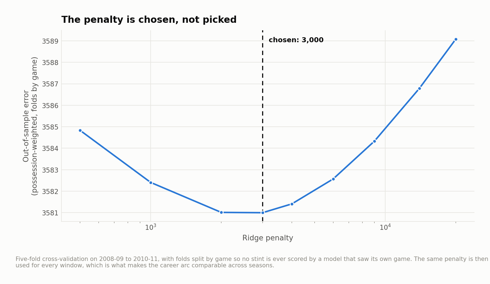
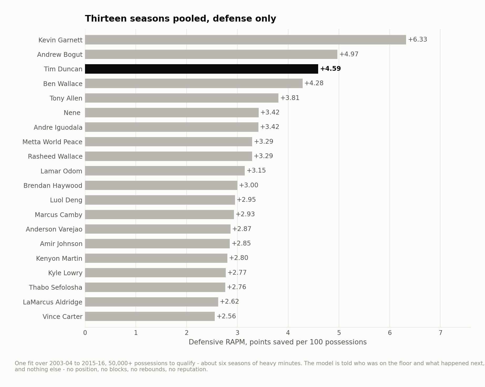
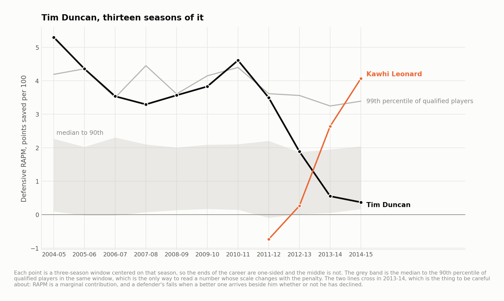

# Tim Duncan's defense, and whether there was a Spurs defense

The Spurs were the best defensive organization of their era and Tim Duncan was
the reason, and those two sentences are usually said as though they were the same
sentence. They are not. One is about a player and one is about a team, and the
play-by-play can be made to answer them separately.

Thirteen seasons, 14,332 games rebuilt possession by possession, 762,571 stints,
2,628,748 possessions, 2003-04 to 2015-16.

**Among players who were on the floor for a career's worth of the era, only Kevin
Garnett rates higher on defense than Tim Duncan. There is no measurable Spurs
defense on top of the Spurs defenders — and the teams where there is one are
Chicago and Indiana.**

---

## The part that is actually hard

The play-by-play records every substitution and never records a lineup. Getting
from one to the other is most of the work, and the check on it is the box score:
walk the game, track who is on the floor, add up each player's seconds, and see
whether it matches the minutes the scorekeeper wrote down.

**14,332 of 15,611 games survive, at a mean per-player error of 0.35 minutes.**
Everything else is dropped rather than patched.

The keep rate is not flat, and this matters for the subject:

| Seasons | Games reconstructed |
|---|---|
| 2003-04 to 2005-06 | 76.3% |
| 2006-07 to 2015-16 | **96.5%** |

The seasons the feed handles worst are the ones in which Duncan was at his peak.

---

## The penalty, chosen rather than picked



Adjusted plus-minus without regularization does not work: teammates share almost
all of their minutes, the design is near-singular, and the fit answers with
enormous confident nonsense. Ridge fixes it by refusing to make a large claim
without a large amount of evidence.

The penalty is chosen by five-fold cross-validation with **folds split by game**,
so no stint is ever scored by a model that saw its own game. It lands at 3,000
and the curve is shallow either side of it, which is worth knowing before anyone
reads a third decimal place off a rating.

The model is also given an unpenalized effect per season and an intercept. Both
matter more than they sound: without them, shrinkage pulls a player toward zero
points per 100 rather than toward league average, and thirteen seasons of
changing league scoring get pushed into the player coefficients. Adding them
turned a leaderboard with Nick Calathes near the top into the one below.

---

## Defense, thirteen seasons pooled



| | Possessions | Defensive RAPM |
|---|---|---|
| Kevin Garnett | 91,643 | **+6.33** |
| Andrew Bogut | 67,414 | +4.97 |
| **Tim Duncan** | **99,990** | **+4.59** |
| Ben Wallace | 59,132 | +4.28 |
| Tony Allen | 54,233 | +3.81 |

Third of the 174 players with 50,000 possessions or more, and **second of the
sixty-nine with 75,000 or more** — the players who were out there for most of the
era, where the estimate has the most behind it and the least room to be a sample.
Raise the floor from ten thousand to seventy-five thousand and his rank moves
from 3rd to 2nd and nothing else about the top of the table changes;
`output/floor_sensitivity.csv` has that in full.

The model is told who was on the floor and what happened next. It is not told
position, blocks, rebounds, defensive rating or reputation.

Two more Spurs, while we are here. **Manu Ginóbili is 5th of 174 in total RAPM**
at +6.47 — ahead of Duncan's +6.14, on 21,600 fewer possessions, which is a
better argument for him than most of the ones people make. Tony Parker, on almost
exactly as many possessions as Duncan, is +2.28, of which the defensive share is
**−0.02**.

---

## The career, and a warning about what RAPM is



Read carelessly, that is a defender falling off a cliff in his mid-thirties: +4.6
in the window centered on 2010-11, +0.3 by 2014-15.

Read carefully, it is two lines crossing. Kawhi Leonard goes from −0.7 to +3.9
over exactly the seasons Duncan goes the other way, and by 2014-15 Leonard is the
Defensive Player of the Year.

RAPM is a **marginal** contribution: what happened when this player was on the
floor, relative to what happened when he was not, given everyone else out there.
When a team replaces the player who covered for everybody with a younger player
who covers for everybody, the older one's marginal contribution falls whether or
not his ability did. Nothing in this data separates the two, and any reading of
that black line that does not mention the orange one is reading it wrong.

---

## Was there a system?

The interesting version of the question is testable. Put a defensive effect for
every team-season into the same model, alongside the players, and ask whether
knowing which team a lineup belonged to helps predict what happened **once you
already know the five defenders**.


| Model | Held-out error |
|---|---|
| Players only | 3,649.82 |
| Plus team-season defense, shrunk like a player | 3,649.04 |
| Plus team-season defense, free | 3,649.65 |

The improvement is 0.78 out of 3,650 — **two hundredths of one per cent** — and
that is the *better* of the two. Consistent in sign across all five folds, and
far too small to be what anyone means by a system. The free version, which is
the one that gives the team block the most room, improves in three folds of five
and by a tenth of that.

The same conclusion arrives from the player side. A team-season effect is nearly
collinear with its own players' defensive coefficients, so which of them gets the
credit is decided by which block carries the penalty, not by the data. Running it
both ways brackets the answer:

| | Players only | Team block shrunk | Team block free |
|---|---|---|---|
| **Tim Duncan** | **+4.59** | **+4.59** | **+4.28** |
| Kevin Garnett | +6.33 | +6.01 | +5.90 |
| Tony Allen | +3.81 | +3.24 | +2.55 |
| Luol Deng | +2.95 | +2.29 | +1.22 |
| Roy Hibbert | +2.07 | +1.45 | +0.34 |

**Duncan's number barely moves.** Hand the team every point of credit the data
will permit and he loses three tenths of a point. The bracket is narrow, which is the
strongest form the answer can take: this is a player effect, not an accounting
convention.


And where *is* the residual team defense? Averaged over the era, San Antonio is
6th at +1.47. Ahead of them are Chicago at +3.58 and Indiana at +2.91 — the
Thibodeau and Vogel teams. The players who lose the most credit when the team
block is set free are Roy Hibbert (Indiana), and Luol Deng and Carlos Boozer
(Chicago) — which is the roster list you would write down from those two team
names.

That is a real finding and it is not the one anybody expects: the era's clearest
statistical case for a defensive *system* over defensive *players* is not the
Spurs.

---

## What this does not do

- **Six seasons of Duncan's career are missing.** He arrived in 1997-98 and the
  play-by-play mirror cannot see before 2003-04. Everything here is his second
  act.
- **No possessions data below the stint.** Possessions are counted from the log
  rather than estimated, which is the right way round, but a stint is still the
  smallest unit and a stint contains everything that happened in it.
- **RAPM is a marginal contribution**, discussed above, and this cannot be fixed
  with more data — it is what the estimator means.
- **No intervals on the ratings.** Ridge coefficients do not come with honest
  standard errors and the bootstrap over 762,000 stints was out of budget. The
  percentile band in figure 03 and the floor sensitivity in
  `output/floor_sensitivity.csv` are what stand in for them.
- **Regular season only.**

---

## Running it

```bash
pip install -r requirements.txt
python src/run_01_stints.py    # play-by-play -> lineups -> stints  (about 10 minutes)
python src/run_02_rapm.py      # the career fit and the rolling windows, figures 01-03
python src/run_03_system.py    # player against team, figures 04-05
```

Or `make all`. Stage 1 is the slow one; the two fits are under a minute each.

```
src/
  config.py        paths, seasons, the possession floors
  lineups.py       who is on the floor, and the box-score check
  possessions.py   counting possessions from the log rather than estimating them
  rapm.py          the design matrices, the ridge, and the penalty conventions
  style.py         one place that decides what every figure looks like
  run_0*.py        the pipeline, in order
output/            every number quoted above, as CSV
figures/           five figures, regenerated from scratch by the pipeline
docs/method.md     longer notes, including what the bracket does and does not do
```

## Data

Play-by-play and player box scores from
[sportsdataverse/hoopR-data](https://github.com/sportsdataverse/hoopR-data), a
mirror of ESPN's public feeds. `data/README.md` has the fetch step and the
coverage cliff.

## License

MIT. See `LICENSE`.
