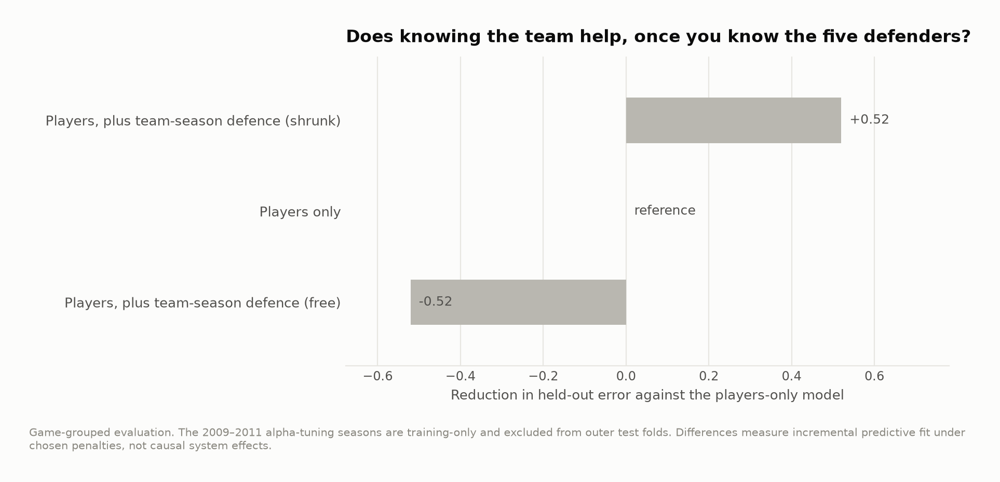
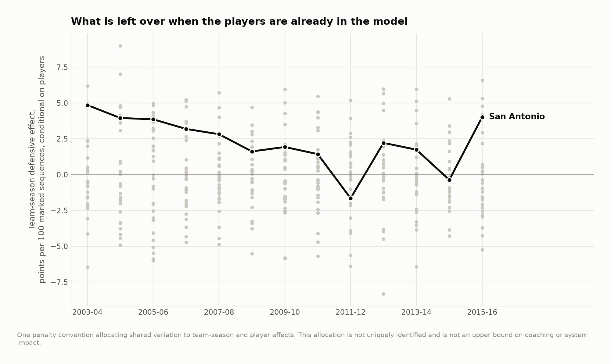

# Method and revision notes

Can public play-by-play separate a player's defensive contribution from the team context around him? This retrospective study covers 2003–04 through 2015–16, pools reconstructed lineups, and examines how adding team-season effects changes a regularized model.

It uses **marked offensive sequences**, not certified possession counts. It is best read as a methods and sensitivity study; a coefficient is not a causal measure of a defender or coach.

## Which games survive reconstruction?

[Result table](../output/reconstruction_audit.csv)

The source feed assigns zero `score_value` to many made free throws in older seasons. The corrected pipeline assigns one point to a marked made free throw and requires team totals to match the box score. Period boundaries reset sequence IDs. Identified technical and retained-ball free throws do not create control changes; their points are separately excluded and audited. Kept games reconcile feed scoring to box scores and modeled ordinary scoring to retained events. Lineups must pass minute checks. Coverage varies by season and exclusion is not random.

## Does a team-season term improve prediction?

[Result table](../output/system_cv.csv)

The 2009–2011 seasons choose the player penalty and are always training-only in the outer evaluation. Test folds contain other games; the published split makes this separation inspectable. This is a retrospective held-out comparison, not a future-season forecast.

## Why player and system credit cannot be uniquely separated

The same players share the floor for the same team. Their defensive indicators overlap strongly with team-season indicators. Different penalty conventions allocate shared variation differently. Similar player estimates under the chosen conventions show limited sensitivity to those particular choices; they do not prove that the estimate is a player effect independent of scheme.

A small change in predictive error also does not show that coaching or a defensive system is unimportant. Their effects can already be absorbed in player coefficients. The team-season estimates are not causal upper bounds on a system.

Rolling windows overlap and use information on both sides of their displayed center season. They describe historical fitted associations. Eligibility thresholds select a subset of players, so comparisons are conditional on that subset, not “best of all time” claims.

## Basketball use

This is useful as a transparent demonstration of regularization, reconstruction quality and identifiability. It belongs behind the portfolio's coaching-oriented studies. A stronger decision tool would combine independently validated possessions, film context and a specific rotation question rather than treating the player/team split as settled.

The result tables are linked and rendered in the main article. Full algorithms and thresholds are in `src/`; source bytes are recorded in `data/source_manifest.json`.
